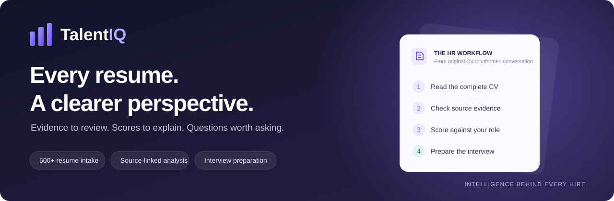
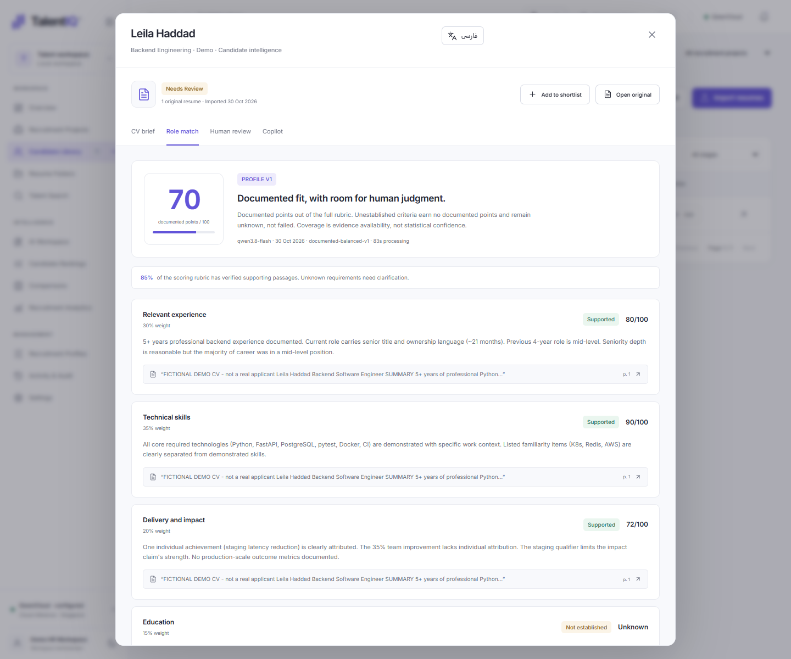
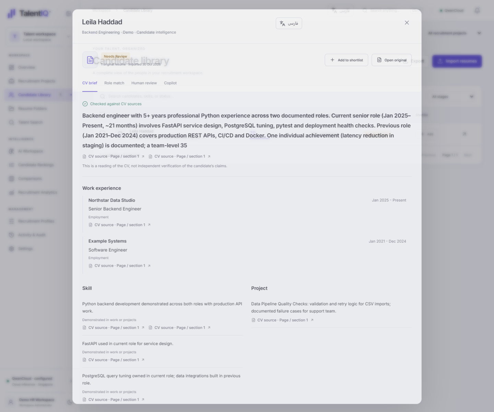
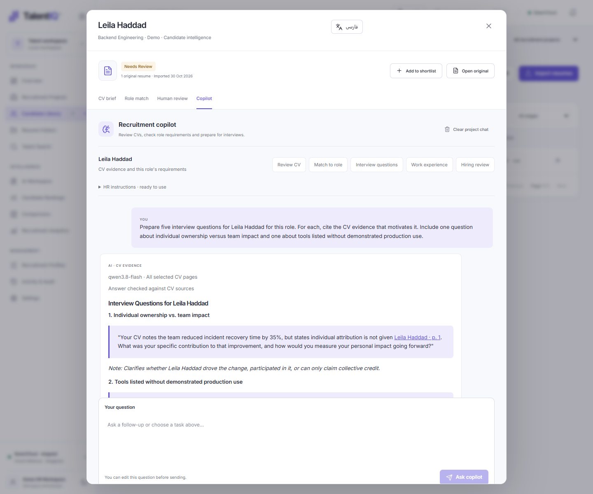
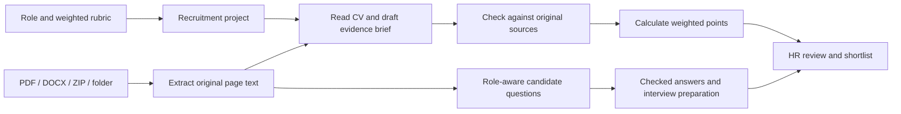

<p align="center">
  
</p>

<p align="center">
  <strong>Turn a folder of resumes into a shortlist you can explain.</strong><br>
  Read the evidence. Understand the fit. Walk into the interview prepared.
</p>

<p align="center">
  <a href="#see-the-analysis">See the analysis</a> ·
  <a href="#500-resumes-one-consistent-workflow">500+ resume workflow</a> ·
  <a href="#how-it-works">How it works</a> ·
  <a href="#quick-start">Get started</a>
</p>

<p align="center">
  <code>PDF · DOCX · ZIP</code> &nbsp;
  <code>English + فارسی</code> &nbsp;
  <code>Local AI or QwenCloud</code> &nbsp;
  <code>Source-linked scores</code>
</p>

---

## Meet TalentIQ

TalentIQ is an AI-assisted recruitment workspace for the work that happens **between receiving a CV and having a useful interview**.

HR defines the role, uploads resumes, and runs a consistent evaluation. TalentIQ reads the CVs, organizes documented experience and qualifications, checks source evidence, calculates weighted scores, highlights missing information, and prepares questions tailored to the candidate and the job.

Ask follow-up questions, compare candidates, build a human-reviewed shortlist, record interview notes, and export the results. The original resume remains one click away.

> **Every score has context. Every important claim has a source. Every interview starts with better questions.**

## See the analysis

<p align="center">
  
</p>

<p align="center"><em>Actual application screenshot. Real QwenCloud analysis of a fictional demonstration CV; no real applicant data is shown.</em></p>

<table>
  <tr>
    <td width="50%"><strong>A CV brief you can inspect</strong><br><br><a href="docs/images/cv-intelligence.png"></a></td>
    <td width="50%"><strong>Questions before the interview</strong><br><br><a href="docs/images/interview-preparation.png"></a></td>
  </tr>
</table>

## 500+ resumes. One consistent workflow.

**HR can import and queue more than 500 resumes in a recruitment workspace.** Select files, choose a folder with subfolders, or upload supported ZIP archives. Organize the intake by project and internal folder, then analyze candidates against the same saved role profile.

A dedicated regression test imports **501 distinct fictional PDFs**, verifies the saved candidate and document records, and queues all 501 for analysis. AI work runs sequentially and completed evaluations are saved, so a large intake can be reviewed over multiple sessions with pause/resume support.

### What HR does

1. **Define the vacancy.** Add the job description, required and preferred qualifications, scoring criteria, and weights.
2. **Bring in the CVs.** Upload individual files, select a folder, or use appropriately sized ZIP batches. Duplicate detection avoids importing the same document twice into a project.
3. **Start the review.** TalentIQ reads each candidate's supplied CV pages and creates a checked brief and a role-match evaluation.
4. **Review the scorecards.** See documented points, evidence coverage, criterion explanations, quotations, and details to clarify.
5. **Build the shortlist.** Compare candidates side by side and record your team's review, notes and next steps.
6. **Prepare the interview.** Ask the copilot for candidate-specific questions, deeper evidence checks, or a comparison against the role.
7. **Share the review.** Export PDF, Excel or CSV reports with evaluation provenance and human review status.

### Practical intake limits

| Item | Behavior |
| --- | --- |
| Workspace intake | 501-document intake and analysis queuing covered by a synthetic regression test |
| Individual file | Up to **25 MB**; searchable PDF or DOCX |
| Folder selection | Files upload individually; supported subfolder paths are preserved internally |
| Direct multi-file API request | Up to **250 files** per request; use additional batches for larger collections |
| ZIP safety | Up to 2,000 entries and 200 MB expanded content, plus per-file and expansion-ratio checks; the uploaded ZIP is also limited to 25 MB |
| Large collections | Prefer folder imports or split archives when a ZIP would exceed its limits |
| AI processing | One active inference operation at a time; completed evaluations are persisted |
| Scanned/image-only CV | Requires OCR preprocessing before import |

**Capacity verification covers ingestion and queuing.** Analysis time for 500+ CVs depends on model, hardware or API throughput, context size, document length and retries. This is not a fixed-time benchmark or a claim that hundreds of candidates run simultaneously.

Reproduce the intake check:

```powershell
python -m pytest tests/test_scale.py -q
```

## What HR gets for each candidate

| Output | What it helps you understand |
| --- | --- |
| **Checked CV brief** | Documented employment, roles, dates, skills, education, qualifications and clarifications |
| **Role-match score** | How much of your weighted rubric is supported by the supplied evidence |
| **Evidence coverage** | Which parts of the rubric have supporting CV passages |
| **Required/preferred checks** | Requirements that are supported and requirements that still need clarification |
| **Source links** | The original document and page/section behind an observation |
| **Interview questions** | Specific topics arising from the candidate's experience and evidence gaps |
| **Recruitment copilot** | Follow-up answers grounded in the selected CVs and role context |
| **Human review record** | Your shortlist, pipeline stage, reviewer, interview date, notes and recorded outcome |

## Interview preparation, ready to ask

The copilot includes prepared HR tasks and prefilled answer instructions. Choose a candidate or comparison, edit the question if needed, and ask.

> **Prepare the interview**  
> Give me five questions for this candidate and this role. Explain which CV evidence motivates each question and what a strong answer should clarify.

> **Check ownership**  
> Which achievements are clearly attributed to the candidate, and which are team results? Suggest follow-up questions about their individual contribution.

> **Verify the details**  
> List the documented employers, roles and dates. Identify missing dates or unclear responsibilities and cite the original pages.

> **Compare candidates**  
> Compare these candidates against the required and preferred qualifications. Keep their evidence separate and identify the main points to verify in interviews.

> **Distinguish experience from a skills list**  
> Which skills are demonstrated in work or projects, and which are only listed? Show the supporting CV passages.

Answers are checked against the supplied sources before publication. Missing details remain points to clarify. Model interpretations still need HR review.

## How it works



### 1. A role becomes a repeatable rubric

Profiles define job context, required/preferred requirements, criterion instructions and weights. Enabled weights must total 100%. Profiles are versioned, and evaluations retain their rubric/model provenance so changes can be identified.

### 2. Original documents become readable evidence

The Python backend parses supported files and stores their originals, extracted text and warnings. References retain original PDF page numbers. DOCX references use extracted text sections because Word pagination is not preserved.

### 3. The AI reads, then checks

Balanced/QwenCloud analysis reads ordinary CVs in context, builds a structured brief, and checks the proposed reading in a second model pass. Larger inputs split into bounded parts with saved checkpoints. Source quotations are validated against extracted document text before contributing to supported results.

### 4. Application code calculates the score

The model interprets the evidence against each criterion. The application attaches weights and computes the documented points. This keeps rubric arithmetic consistent and makes the result inspectable.

### 5. HR can keep questioning the evidence

The copilot combines the selected candidate's original CV context with the role and review instructions. Candidate scope, citations and answer checks help keep comparisons grounded in the correct documents.

## Understand the score

TalentIQ separates **documented points** from **evidence coverage**.

```text
Documented points = sum(criterion score × criterion weight / 100)
Evidence coverage = sum(weights of criteria with established supporting evidence)
```

Example:

| Criterion | Weight | Supported criterion score | Documented points |
| --- | ---: | ---: | ---: |
| Relevant experience | 30% | 80/100 | 24 |
| Technical skills | 35% | 90/100 | 31.5 |
| Delivery and impact | 20% | 70/100 | 14 |
| Education | 15% | Not established | — |
| **Total** | **100%** | **85% evidence coverage** | **69.5/100** |

“Not established” means the supplied CV did not establish the criterion. It does not prove the candidate lacks that qualification. Coverage is evidence availability, not statistical confidence. Scores are advisory role-match information; HR records the actual hiring outcome.

## Choose how the AI runs

| | Local AI · Ollama | QwenCloud API |
| --- | --- | --- |
| Model execution | On your machine | Configured provider endpoint in Singapore |
| Setup | Install Ollama and the selected models | Configure your own server-side API key |
| Local models | Loaded as needed | Not started or used |
| Data boundary | Local inference | CV/task context is sent to the provider for AI requests |
| Performance | Depends on CPU/GPU, memory and model | Depends on provider throughput, context and network |

The interface, Python backend, SQLite workspace and original-file storage run on your application host in both modes. Provider keys are write-only through the UI/API and kept outside normal workspace backups. **No API key or applicant database is included in this repository.**

## English and Persian, throughout the workflow

Switch the interface between **English and فارسی**. Persian mode includes RTL layouts, bundled Vazirmatn typography, translated navigation and form labels, prepared HR instructions, and Persian AI explanations. The source CV can remain in English; names, IDs and source quotations retain their original form.

## Quick start

### Requirements

- **Node.js 22+**; Node.js 24 recommended.
- **Python 3.11–3.13**.
- Your chosen AI provider: **Ollama** with installed models, or your own **QwenCloud** key.

### Windows setup

```powershell
git clone https://github.com/bytebymint/talentiq.git
cd talentiq

# Install application dependencies and build the interface.
powershell -ExecutionPolicy Bypass -File .\Install-TalentIQ.ps1

# Start the application.
powershell -ExecutionPolicy Bypass -File .\Start-TalentIQ.ps1
```

Open **http://127.0.0.1:3000**, create your administrator account, and select the AI provider in **AI Workspace**. There is no default username or password.

For Local AI, install the runtime and models during setup:

```powershell
powershell -ExecutionPolicy Bypass -File .\Install-TalentIQ.ps1 -IncludeAI
```

For normal use after installation, double-click **TalentIQ.cmd**. First-time model downloads can be large; ordinary startup reuses installed models.

<details>
<summary><strong>Manual development setup</strong></summary>

```powershell
python -m venv .venv
.\.venv\Scripts\python.exe -m pip install -r backend/requirements.txt
npm ci
```

Start the backend and frontend in separate terminals:

```powershell
.\.venv\Scripts\python.exe -m uvicorn backend.main:app --host 127.0.0.1 --port 8000 --no-access-log
```

```powershell
npm run dev
```

The frontend proxies same-origin API requests to the backend on port 8000. Both default to loopback. Run a single backend process; job orchestration is intentionally serialized.

</details>

## Built for daily HR work

- **Recruitment projects:** one hiring context, one saved rubric, a clear candidate library.
- **Folders and duplicate checks:** preserve supported intake structure and avoid duplicate documents in the same project.
- **Resumable analysis:** completed evaluations and long-document parts survive ordinary interruption.
- **Side-by-side comparisons:** compare 2–6 candidates and save comparison sessions.
- **Human review:** notes, shortlist controls, pipeline stages, reviewer assignments and interview dates.
- **Selected-resume deletion:** confirm the exact files; other resumes and HR notes are preserved, and affected AI analyses are cleared for a fresh review.
- **Reports:** PDF, XLSX and CSV exports with evaluation provenance and human review status.
- **Accounts and access:** administrator, reviewer and read-only roles; current-password verification for username/password changes.
- **Backups and audit:** workspace export/restore, configurable retention review and activity records.

## Verification

The test suite uses temporary databases and fictional documents. It covers imports, source validation, scoring, account changes, human review, deletion scope, reports, project context, provider selection and job recovery. The 501-resume check is included in source.

```powershell
.\.venv\Scripts\python.exe -m pytest -q
npm run typecheck
npm run build
npm run test:ui
```

The screenshots use an isolated demonstration workspace and a fictional CV. They are product examples, not a guarantee of identical scores, response time or model accuracy on other documents.

## Documentation

| Guide | Read it for |
| --- | --- |
| [Detailed user guide](docs/USER-GUIDE.md) | Setup, providers, accounts, scoring, backups and operational limits |
| [HR workflow](docs/HR-WORKFLOW.md) | Role setup, evidence review, candidate discussion and interview preparation |
| [CV understanding](docs/CV-UNDERSTANDING.md) | Checked briefs, source validation and analysis behavior |
| [QwenCloud setup](docs/QWENCLOUD.md) | Server-side keys and remote processing boundaries |
| [Persian interface](docs/PERSIAN.md) | Language behavior, RTL and source-text preservation |
| [Architecture](docs/ARCHITECTURE.md) | Components, persistence and processing boundaries |
| [Troubleshooting](docs/TROUBLESHOOTING.md) | Common setup and runtime issues |

### Current boundaries

Image-only documents need OCR preprocessing. CV claims are not independently authenticated. Model output can be wrong, and evidence guards are not a fairness or accuracy certification. All authenticated workspace users share the workspace; granular project ACLs and email-based account recovery are not implemented. Protect backups and do not expose the default local configuration directly to an untrusted network.

The application owner has not selected an application license. The bundled report font retains its [SIL Open Font License](public/fonts/OFL.txt).

---

<p align="center"><strong>TalentIQ</strong><br>Intelligence behind every hire.</p>
